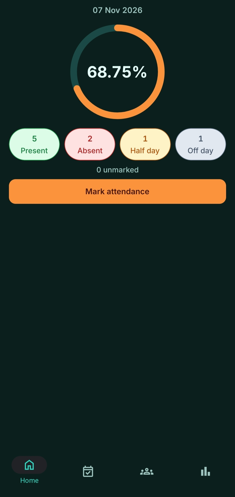
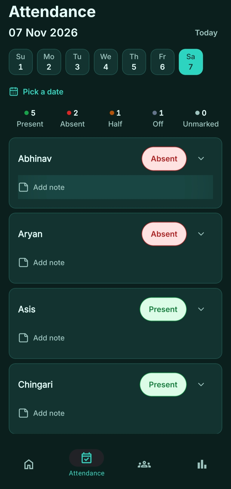
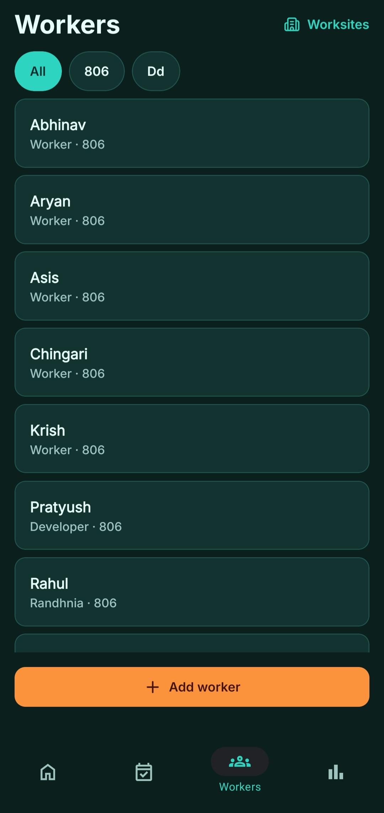
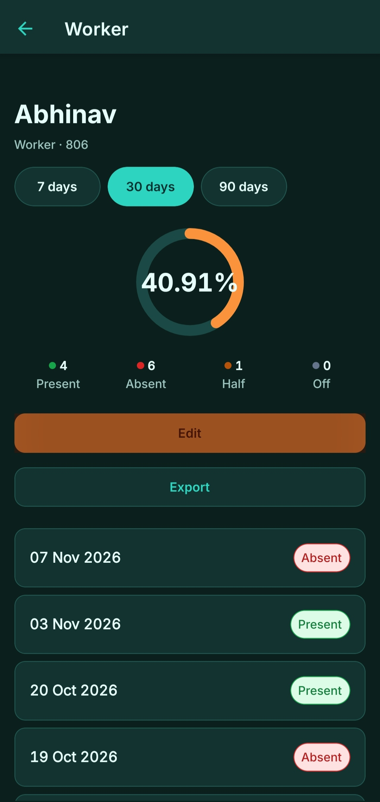
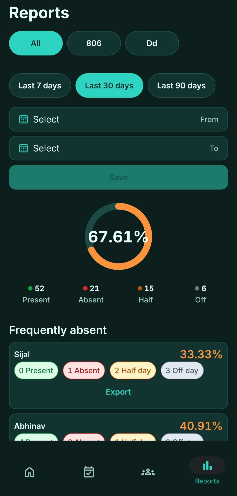
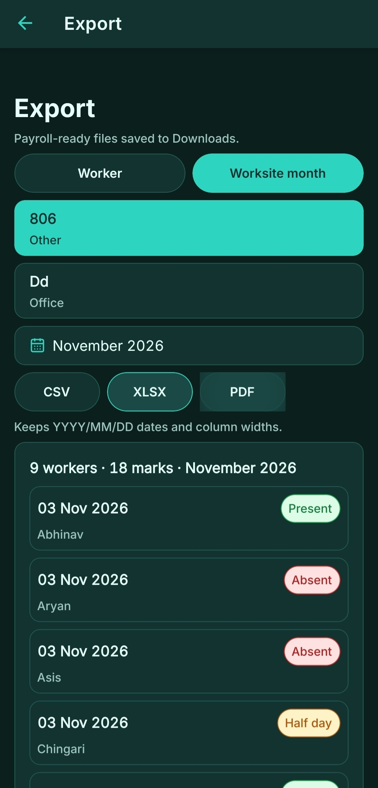

# Hazra

**Offline-first staff attendance register for worksites.** Mark a day's attendance in seconds — no accounts, no network, no cloud.

Hazra keeps worksites, workers and attendance in SQLite on the device, so the register opens on a site with no signal and data leaves the phone only when you export or back up. Each worker is marked Present, Absent, Half day or Off day, entries can carry notes, and any period exports as CSV, XLSX or PDF. Expo SDK 58 · React Native 0.88 · TypeScript strict.

## Screens

| Home | Attendance | Workers |
| --- | --- | --- |
|  |  |  |

| Worker profile | Reports | Export |
| --- | --- | --- |
|  |  |  |

Dark mode, 1080 px wide, real seed data. Every screen is described in text below, so nothing here is image-only.

## Why this instead of what you already use

- **Instead of a paper register:** totals are computed, a worker's last 90 days are one tap away, and the month leaves as a spreadsheet rather than a photographed page.
- **Instead of a cloud attendance app:** no account, no per-seat billing, no staff list uploaded. The failure mode is "battery died", not "the sync failed".
- **Instead of a spreadsheet:** four fixed statuses instead of free text, so counts can't drift and history is built in.

**When not to use it:** single-device by design — no sync, no admin roles, no server. If several supervisors need one live roster, this is the wrong tool — v1 backs up by hand, one JSON file at a time.

## What is in the app

| Area | What it does |
| --- | --- |
| **Home** | Today's counts per status, unmarked-worker count, one tap into the register |
| **Attendance** | Date strip, calendar picker, worksite filter, tap-to-cycle status pills, notes, live counts |
| **Workers** | Roster with per-site filtering, add/edit, remove that keeps history |
| **Worker profile** | Attendance-rate ring, 7/30/90-day periods, tap-to-call, full marked-day history |
| **Reports** | Site and period filters, per-worker ranking, a frequently-absent bottom three, and a daily trend chart |
| **Export** | Worker history or worksite-month register as CSV, XLSX or PDF |

## Requirements

- **Node 22.13+, 24.3+ or 26+** — the range `expo` declares in its `engines` field. No `.nvmrc`.
- **A development build, not Expo Go** — `expo-dev-client` is installed and the app uses `expo-sqlite`, `expo-print` and `expo-sharing`.
- Android Studio for Android, Xcode for iOS. Web needs neither.

## Run it

```bash
npm install

npx expo run:android    # or: npx expo run:ios
```

The first run compiles the native app and boots it; the SQLite schema (three tables, `user_version = 1`) is created on first launch. After that, `npx expo start` is enough for JS-only changes.

Web, no native toolchain required:

```bash
npm run web
```

There is no hosted demo and no prebuilt binary — this is a source build.

`ios/` and `android/` are generated and gitignored. Configure native behaviour in `app.json` and config plugins, not by editing those directories.

## Project layout

```
src/app/          Expo Router routes only
  (tabs)/         Home · Attendance · Workers · Reports
  worksites, worker/[id], worker-form, worksite-form, export, backup
src/components/   UI pieces (status pill, date strip, ring, charts, forms)
src/db/           SQLite schema, DAOs, backup/restore
src/utils/        Pure logic: attendance math, date keys, reports, export, files
src/constants/    Design tokens + the four-status contract
scripts/          Node self-check gates
```

Attendance maths is deliberately pure: `summarize()` and the export serializers take data in and return values, with no database imports, so they can be checked without a device.

## Data and privacy

- Everything is local. There is no `fetch`, `XMLHttpRequest`, `axios` or `WebSocket` call anywhere in `src/` — the app has no network layer to leak through.
- Schema: `worksites`, `workers`, `attendance`, with foreign keys on, a `CHECK` constraint on status values and `UNIQUE(worker_id, date)`.
- Removing a worker or worksite deactivates the row (`is_active = 0`) instead of deleting it, so history survives.
- CSV output is RFC-4180 escaped, and cells starting with `=`, `+`, `-` or `@` are prefixed so spreadsheets treat them as text rather than formulas.


## Checks

There is no test runner and no CI. The repo uses assertion scripts instead:

```bash
npx tsc --noEmit
node scripts/verify-status-contract.mjs
node scripts/verify-date-utils.mjs
node scripts/verify-ids.mjs
node scripts/verify-summarize.mjs
node scripts/verify-export.mjs
node scripts/verify-tab-shell.mjs
node scripts/verify-theme-tokens.mjs
node scripts/verify-theme-scale.mjs
node scripts/verify-contrast.mjs
node scripts/verify-app-assets.mjs
```

`verify-contrast.mjs` enforces WCAG AA (≥4.5:1) for every text pair in both light and dark mode.

## Status

Feature-complete through the build-out phases: worksites, workers, the daily register, worker profiles, reports, export and backup all work. **Phase 9 (Build & Ship) has not started** — there is no `eas.json`, no CI pipeline and no signed build yet.

Honest gaps: no unit-test runner (the assertion scripts cover contracts and pure maths, not screens), and several on-device proofs are still deferred until a development build is wired into a release process.

## Licence

MIT — see [`LICENSE`](LICENSE).

The repository is marked `"private": true` in `package.json`, which prevents an accidental publish to npm; it does not affect the licence.
